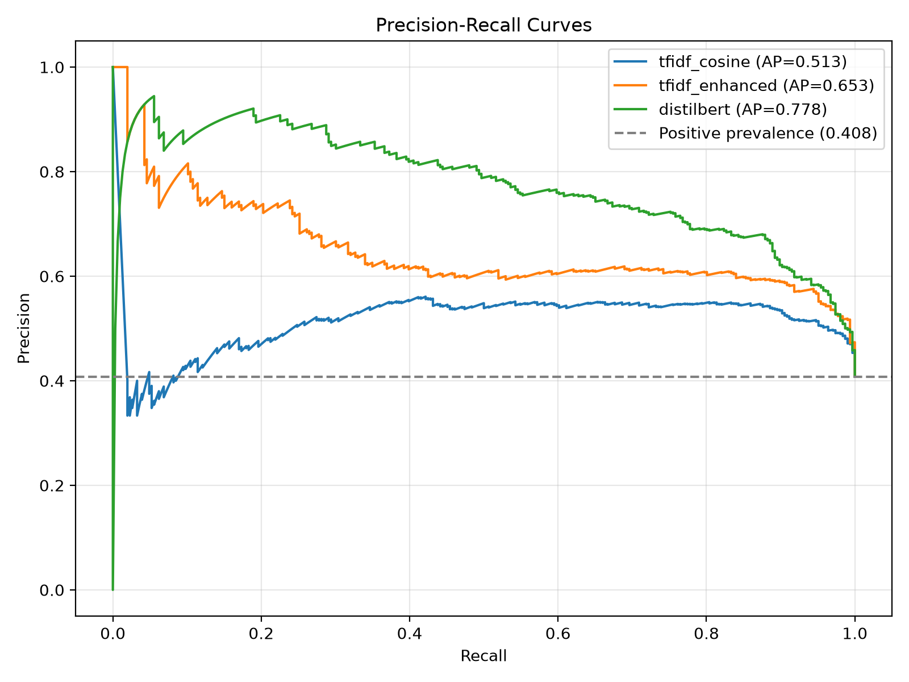
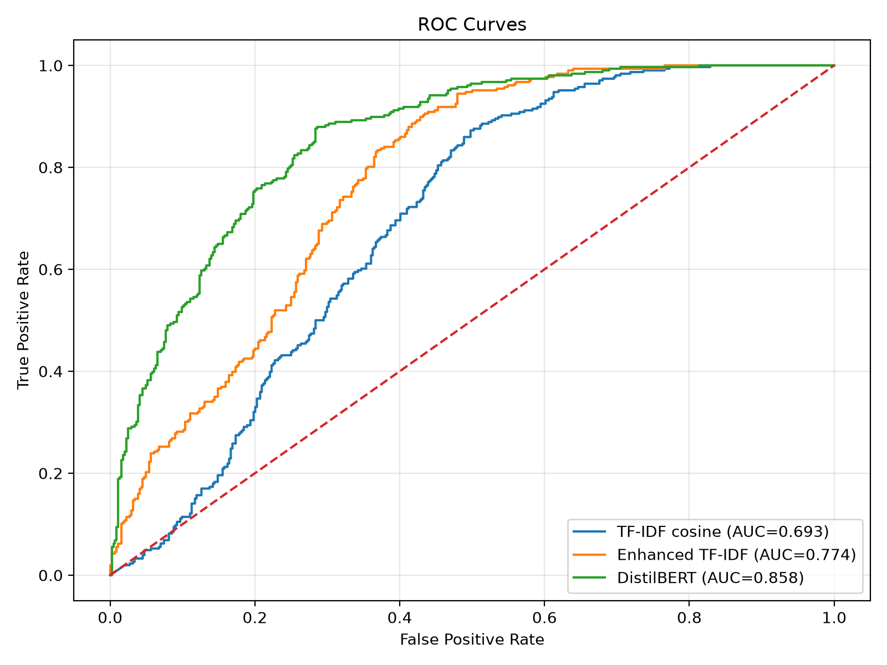

# BERT Duplicate Question Detector

A reproducible NLP and machine learning pipeline for identifying semantically duplicate questions using fine-tuned DistilBERT, benchmarked against classical TF-IDF and logistic regression models.

The project covers leakage-aware data preparation, transformer fine-tuning, validation-based threshold optimisation, held-out evaluation, component-aware statistical uncertainty analysis, qualitative error analysis, local inference and automated testing.

## Key Findings

- **DistilBERT outperformed the strongest classical baseline on ranking metrics.** Compared with enhanced TF-IDF, average precision improved by 0.1251 (95% CI: [0.0695, 0.1827]) and ROC-AUC improved by 0.0836 (95% CI: [0.0515, 0.1163]). Both paired component-bootstrap confidence intervals exclude zero.
- **The F1 improvement was not statistically established.** DistilBERT achieved an observed F1 improvement of 0.0362 over enhanced TF-IDF, but the 95% confidence interval of [-0.0012, 0.0740] includes zero.
- **Qualitative error analysis identified scope and intent differences as the most frequent category among sampled false positives.** Of 30 sampled false positives, 18 (60.0%) involved scope or intent differences.
- **Missed paraphrases were the most frequent category among sampled false negatives.** Of 30 sampled false negatives, 14 (46.7%) were classified as missed paraphrases.
- **Some apparent model errors may reflect dataset-label ambiguity.** Across 60 sampled errors, 17 were assessed as ambiguous and 9 as possible dataset-label errors. These assessments were AI-assisted and have not been independently validated.

## Overview

Duplicate question detection is a binary classification task: determining whether two questions express the same underlying intent despite differences in wording or sentence structure.

This project compares lexical similarity methods with transformer-based semantic classification using the Quora Question Pairs (QQP) dataset.

**Models:**

- Majority-class and all-positive reference baselines
- TF-IDF cosine similarity + logistic regression
- Enhanced TF-IDF features + logistic regression
- Fine-tuned `distilbert-base-uncased`

**Stack:** Python, PyTorch, Hugging Face Transformers, scikit-learn, SciPy, pandas, NetworkX, Matplotlib, pytest and GitHub Actions.

## Dataset and Methodology

The experiment uses 5,000 question pairs from Hugging Face's `SetFit/qqp` dataset, comprising 1,838 duplicates (36.76%) and 3,162 non-duplicates (63.24%).

### Question-Disjoint Splitting

Random splitting can introduce leakage when the same question appears in multiple dataset partitions.

To address this, questions were represented as graph nodes and question pairs as edges. Connected components were used to construct question-disjoint splits.

| Split | Pairs | Duplicate pairs | Duplicate rate |
|---|---:|---:|---:|
| Training | 3,500 | 1,250 | 35.71% |
| Validation | 750 | 282 | 37.60% |
| Test | 750 | 306 | 40.80% |
| **Total** | **5,000** | **1,838** | **36.76%** |

An automated audit confirmed **zero shared exact question strings** between the three splits.

All models were evaluated on the same held-out test set. Classification thresholds were selected using validation data rather than the test set.

This splitting procedure reduces exact-question overlap but does not eliminate every form of semantic similarity or dataset bias. The test set also has a higher duplicate prevalence than the full sample, which should be considered when interpreting precision, F1 and average precision.

### Test-Set Component Structure

An additional audit of the 750 test pairs found:

| Statistic | Value |
|---|---:|
| Connected components | 722 |
| Single-pair components | 698 |
| Components containing multiple pairs | 24 |
| Pairs belonging to multi-pair components | 52 (6.93%) |
| Largest component | 4 pairs |

These components form the resampling units for the component-aware bootstrap described below.

## Models and Training

### Classical Baselines

Four reference approaches were evaluated:

1. **Majority class:** Predicts the most frequent training label for every pair.
2. **All positive:** Predicts every question pair as a duplicate.
3. **TF-IDF cosine:** Computes cosine similarity between separately vectorised questions and uses logistic regression for classification.
4. **Enhanced TF-IDF:** Combines cosine similarity, absolute TF-IDF differences, elementwise TF-IDF products and lexical overlap features (Jaccard similarity and containment) in a logistic regression classifier.

TF-IDF vocabulary fitting and classifier training used training data only. Classification thresholds were selected by maximising validation F1.

### DistilBERT

DistilBERT was fine-tuned for binary question-pair classification using the following configuration:

| Parameter | Value |
|---|---|
| Model | `distilbert-base-uncased` |
| Epochs | 3 |
| Batch size | 8 |
| Learning rate | 2e-5 |
| Maximum sequence length | 128 |
| Optimizer | AdamW |
| Seed | 42 |
| Acceleration | Apple Silicon MPS |

The best checkpoint was selected using validation F1 at the default 0.5 threshold. A subsequent validation-based search selected an inference threshold of `0.15`.

The corresponding thresholds for the cosine and enhanced TF-IDF baselines were `0.25` and `0.30`, respectively.

The relatively low DistilBERT threshold reflects the operating point selected by the validation F1 search. It should not, by itself, be interpreted as evidence of poor probability calibration or a particular underlying cause.

## Results

Performance on **750 held-out question pairs**:

| Metric | Majority class | All positive | TF-IDF cosine | Enhanced TF-IDF | DistilBERT |
|---|---:|---:|---:|---:|---:|
| Accuracy | 0.5920 | 0.4080 | 0.6400 | 0.7040 | **0.7707** |
| Precision | 0.0000* | 0.4080 | 0.5352 | 0.5950 | **0.6893** |
| Recall | 0.0000 | **1.0000** | 0.8954 | 0.8595 | 0.7974 |
| F1 | 0.0000 | 0.5795 | 0.6699 | 0.7032 | **0.7394** |

*The majority-class model predicts no positive examples, so positive-class precision is mathematically undefined (0/0). The evaluation convention reports it as 0.0000.*

DistilBERT achieved an observed F1 improvement of **3.62 percentage points** over enhanced TF-IDF and **6.95 percentage points** over the cosine baseline. The statistical uncertainty associated with these differences is examined below.

### Threshold-Independent Evaluation

| Metric | TF-IDF cosine | Enhanced TF-IDF | DistilBERT |
|---|---:|---:|---:|
| Average precision | 0.5130 | 0.6525 | **0.7776** |
| ROC-AUC | 0.6933 | 0.7741 | **0.8576** |

These metrics assess ranking and discrimination without relying on the selected classification thresholds. DistilBERT achieved higher observed values on both measures.

### Precision-Recall Curves



The dashed horizontal line represents the positive-class prevalence of 0.408 in the test set. The extreme low-recall region is based on very few top-ranked predictions and should not be overinterpreted.

### ROC Curves



The diagonal dashed line represents random ranking performance.

### Component-Aware Statistical Evaluation

To quantify uncertainty while accounting for exact-question overlap within the test set, the evaluation uses a **paired connected-component bootstrap**.

Rather than resampling individual question pairs independently, the procedure resamples all 722 test-set connected components with replacement. Every selected component contributes all of its question pairs, preserving the observed within-component structure.

The procedure uses:

- 5,000 bootstrap replicates
- A fixed random seed of 42
- The same sampled components for all models in each replicate
- Percentile-based 95% confidence intervals
- Paired differences calculated within each bootstrap replicate

Because connected components contain different numbers of pairs, bootstrap replicate sizes can vary slightly.

#### Individual Model Confidence Intervals

| Model | F1 (95% CI) | Average precision (95% CI) | ROC-AUC (95% CI) |
|---|---|---|---|
| TF-IDF cosine | 0.6699 [0.6311, 0.7052] | 0.5130 [0.4617, 0.5731] | 0.6933 [0.6550, 0.7301] |
| Enhanced TF-IDF | 0.7032 [0.6640, 0.7397] | 0.6525 [0.5933, 0.7111] | 0.7741 [0.7409, 0.8061] |
| **DistilBERT** | **0.7394 [0.6995, 0.7768]** | **0.7776 [0.7248, 0.8298]** | **0.8576 [0.8309, 0.8829]** |

#### Paired Model Comparisons

| Comparison | Metric | Observed difference | 95% paired component-bootstrap CI |
|---|---|---:|---|
| DistilBERT - enhanced TF-IDF | F1 | +0.0362 | [-0.0012, 0.0740] |
| DistilBERT - enhanced TF-IDF | Average precision | +0.1251 | **[0.0695, 0.1827]** |
| DistilBERT - enhanced TF-IDF | ROC-AUC | +0.0836 | **[0.0515, 0.1163]** |
| DistilBERT - TF-IDF cosine | F1 | +0.0695 | **[0.0299, 0.1096]** |
| DistilBERT - TF-IDF cosine | Average precision | +0.2646 | **[0.2041, 0.3209]** |
| DistilBERT - TF-IDF cosine | ROC-AUC | +0.1643 | **[0.1241, 0.2047]** |

**Interpretation:** The confidence intervals for DistilBERT's average precision and ROC-AUC improvements over enhanced TF-IDF exclude zero. The corresponding F1 interval includes zero, so a positive F1 difference is not established at the 95% confidence level by this procedure.

These findings support improved ranking performance on the evaluated sample, while distinguishing that result from uncertainty in threshold-dependent classification performance.

#### McNemar's Test and Operating-Point Effects

The conventional exact McNemar test for classification correctness produced:

- **DistilBERT vs enhanced TF-IDF:** p = 0.000379
- **DistilBERT vs TF-IDF cosine:** p = 2.58e-10

McNemar's test examines disagreement in whether individual predictions are correct. It is related to accuracy, not F1, and the conventional pair-level test used here does not adjust for connected-component clustering.

Consequently, McNemar's result and the F1 bootstrap interval are not contradictory. DistilBERT has higher accuracy than enhanced TF-IDF (0.7707 vs 0.7040), whereas the validation-F1-optimised operating points favour recall to different degrees. The enhanced TF-IDF classifier has higher recall but lower precision, narrowing the F1 difference despite its lower accuracy.

The bootstrap results are conditional on the fitted models and observed test sample. Component resampling accounts for exact-question connectivity within the test set, but does not eliminate all possible semantic dependence, measure variation from retraining or establish generalisation beyond QQP-style data.

### Reproducible Evaluation Artifacts

The repository includes:

- `results/baseline_comparison.json` — baseline metrics and selected thresholds
- `results/statistical_evaluation.json` — component-aware confidence intervals and paired comparisons
- `results/evaluation_predictions.csv` — text-free aligned prediction records for all three score-based models
- `results/plots/precision_recall_curves.png` — precision-recall comparison
- `results/plots/roc_curves.png` — ROC comparison
- `results/error_annotation_summary.csv` — aggregate qualitative error-analysis counts

The text-free prediction file contains pair indices, component identifiers, true labels, model scores and binary predictions. It enables the statistical analysis to be reproduced without retraining the models or redistributing the question text.

The error-annotation summary contains only aggregate counts and percentages. Question-level annotation data is retained locally.

## Error Analysis

DistilBERT produced the following errors on the 750-pair held-out test set:

- **110 false positives**
- **62 false negatives**

A reproducible sample of 60 errors was examined to investigate the semantic characteristics of incorrect predictions.

The sample contained:

- 30 false positives sampled from the 110 available false positives
- 30 false negatives sampled from the 62 available false negatives
- A fixed sampling seed of 42

Each question pair received two annotations:

1. **Label assessment:** Whether the prediction appeared to be a clear model error, an ambiguous case or a possible dataset-label error.
2. **Semantic category:** The main semantic relationship or difference between the two questions.

The classifications were proposed with AI assistance and were not independently validated by human annotators. The analysis is therefore exploratory.

### Label Assessment

| Assessment | False positives | False negatives | Total |
|---|---:|---:|---:|
| Clear model error | 21 (70.0%) | 13 (43.3%) | 34 |
| Ambiguous | 6 (20.0%) | 11 (36.7%) | 17 |
| Possible dataset-label error | 3 (10.0%) | 6 (20.0%) | 9 |
| **Total** | **30** | **30** | **60** |

Among sampled false positives, 21 of 30 were classified as clear model errors.

Among sampled false negatives, 13 of 30 were classified as clear model errors, while 17 were classified as ambiguous or possible dataset-label errors.

This difference suggests that uncertainty about question equivalence and dataset labels may contribute to the observed false-negative count. However, these judgments have not been independently verified and do not establish that the original QQP labels are incorrect.

### Semantic Error Categories

| Semantic category | False positives | False negatives |
|---|---:|---:|
| Scope/intent difference | 18 (60.0%) | 12 (40.0%) |
| Missed paraphrase | 3 (10.0%) | 14 (46.7%) |
| Entity/referent difference | 4 (13.3%) | 3 (10.0%) |
| Numerical/identifier difference | 4 (13.3%) | 0 (0.0%) |
| Negation/logical difference | 1 (3.3%) | 0 (0.0%) |
| Implicit semantic equivalence | 0 (0.0%) | 1 (3.3%) |
| **Total** | **30 (100%)** | **30 (100%)** |

#### False Positives: Scope and Intent Differences

Scope and intent differences were the most frequently assigned semantic category among false positives, accounting for 18 of the 30 sampled cases.

For example, the model incorrectly classified the following questions as duplicates:

- "What is the difference between tomato sauce, tomato ketchup and tomato condiment?"
- "What is the difference between tomato sauce and tomato ketchup?"

Although the questions are closely related, the first explicitly includes an additional category.

Other observed false positives involved changes to numerical values, identifiers and referenced entities.

Examples included:

- Heathrow Terminal 3 versus Terminal 5
- Completing a JEE syllabus in two months versus one year
- An eight-metre structural span versus a six-metre span

These examples illustrate how high lexical similarity can coexist with differences that change the requested information.

#### False Negatives: Missed Paraphrases

Missed paraphrases were the most frequently assigned category among false negatives, accounting for 14 of the 30 sampled cases.

For example:

- "How are long distance relationships maintained?"
- "How will long distance relationship work?"

The two questions express substantially similar intentions using different wording, but the model predicted that they were not duplicates.

Another example involved:

- "What are web applications?"
- "What is web application?"

The model failed to classify this near-identical singular/plural variation as a duplicate.

These cases suggest that some semantically equivalent questions remain difficult for the fitted classifier at its validation-selected operating threshold.

#### Possible Dataset-Label Problems

Nine of the 60 sampled errors were flagged as possible dataset-label errors.

For example, one pair labelled as a duplicate asked whether hamsters can eat cucumber versus whether hamsters should eat popcorn.

Another pair compared the effects of different historical earthquakes.

These examples raise questions about the consistency of the dataset's duplicate labels. However, the annotations are preliminary assessments rather than confirmed label corrections.

### Interpretation and Limitations

The qualitative analysis provides additional context beyond accuracy, F1, average precision and ROC-AUC, but several limitations are important:

- **Balanced error sampling:** The sample contains equal numbers of false positives and false negatives, unlike the full test-set error distribution. Reported percentages describe each sampled error type separately.
- **Sample size:** Only 60 of the 172 test errors were annotated.
- **Annotation reliability:** Categories were proposed with AI assistance, without independent human validation or inter-annotator agreement measurement.
- **Label uncertainty:** Possible dataset-label errors have not been confirmed through independent adjudication.
- **Descriptive categories:** Semantic categories describe question-pair characteristics, not necessarily the causal mechanisms underlying model predictions.
- **Model scores:** The reported softmax scores have not been calibrated and should not be interpreted as reliable probabilities.

The results are useful for identifying candidate weaknesses and motivating further robustness testing, but they should not be treated as definitive estimates of model failure mechanisms.

### Reproducibility and Data Handling

The qualitative error-analysis workflow uses:

- `prepare_error_annotations.py` — creates the reproducible 60-example sample
- `annotate_errors.py` — provides an interactive annotation interface
- `summary_error_annotations.py` — validates annotations and generates aggregate category counts
- `results/error_annotation_summary.csv` — stores the aggregate results

The local file `results/error_annotation_sample.csv` contains question-level text and annotations and is excluded from Git.

The committed summary contains aggregate category counts and percentages without redistributing the original question text.

## Installation and Usage

Python 3.12 was used during development.

### 1. Clone and install

```bash
git clone https://github.com/Brxckfuller/bert-duplicate-detector.git
cd bert-duplicate-detector

python3.12 -m venv .venv
source .venv/bin/activate
python -m pip install -r requirements.txt
```

### 2. Prepare and audit the dataset

```bash
python prepare_data.py
python audit_data.py
```

### 3. Train and evaluate

```bash
python baseline.py
python baseline_comparison.py
python train_bert.py
python evaluate_bert.py
python record_checkpoint.py
```

The trained checkpoint is saved locally under `models/distilbert-best/`. Training metadata and the selected inference threshold are recorded alongside it.

### 4. Run statistical evaluation

First, generate the question-level DistilBERT prediction records:

```bash
python error_analysis.py
```

Then run:

```bash
python statistical_evaluation.py
```

This verifies test-example alignment, reconstructs connected components, calculates paired component-bootstrap confidence intervals, performs conventional McNemar tests, exports text-free prediction records and generates precision-recall and ROC plots.

### 5. Run qualitative error analysis

Generate the reproducible sample:

```bash
python prepare_error_annotations.py
```

Annotate the sampled question pairs:

```bash
python annotate_errors.py
```

After all 60 examples have been annotated, generate the summary:

```bash
python summary_error_annotations.py
```

The summary script validates the number of examples, annotation categories, unique identifiers and balance between false positives and false negatives before exporting aggregate results.

The question-level annotation CSV is retained locally and excluded from Git.

### 6. Run inference

```bash
python predict.py --q1 "How do neural networks learn?" --q2 "How are neural networks trained?"
```

Example output:

```text
Duplicate score: 0.5299
Threshold: 0.15
Prediction: Duplicate
```

### 7. Run tests

```bash
python -m pytest -q
```

The current local test suite contains **30 passing tests**, including checks for connected-component assignment, bootstrap cluster preservation, confidence intervals, classification metrics, McNemar's exact test, and contrastive robustness benchmark structure and metric calculations.

Unit tests also run automatically through GitHub Actions on pushes and pull requests to `main`. The integration test requires a locally trained checkpoint.

## Reproducibility

The repository includes dataset preparation, baseline training, transformer fine-tuning, evaluation, statistical analysis, qualitative error analysis, inference and testing code, along with pinned dependencies and checkpoint configuration tracking.

Aggregate evaluation metrics, plots, text-free prediction records and aggregate error-annotation summaries are intended to be committed so the analyses can be inspected without retraining.

Dataset files, question-level prediction records, question-level annotation records and trained weights are excluded from Git. Reproducing the complete training experiment requires downloading the dataset and training the model locally.

Reproducing the qualitative annotation summary additionally requires completing the annotation process. The annotation decisions are not automatically regenerated from the model predictions.

Exact results may vary with hardware, dependency versions and random-number generation.

## Exploratory Robustness Evaluation

Two hand-constructed diagnostic evaluations were conducted using the existing DistilBERT checkpoint and its validation-selected inference threshold of 0.15. No retraining or threshold adjustment was performed.

### Initial diagnostic evaluation

| Category | Correct | Accuracy |
|---|---:|---:|
| Numerical differences | 0/4 | 0% |
| Negation and logical contrasts | 0/4 | 0% |
| Entity differences | 3/4 | 75% |
| Paraphrases | 3/4 | 75% |
| **Overall** | **6/16** | **37.5%** |

### Contrastive evaluation

Each of 16 groups contains an intended equivalent paraphrase and a meaning-changing contrast (32 pairs total).

| Category | Equivalent correct | Contrast correct | Correct ordering |
|---|---:|---:|---:|
| Numerical | 4/4 | 0/4 | 2/4 |
| Negation | 2/4 | 0/4 | 0/4 |
| Entity | 1/4 | 3/4 | 4/4 |
| Paraphrase | 3/4 | 3/4 | 2/4 |

Overall pair accuracy was **16/32 (50.0%)**. Both predictions were correct in **2/16 groups**, and the intended equivalent received a higher score in **8/16 groups**.

### Interpretation and limitations

The results suggest potential weaknesses in numerical sensitivity and negation. These are exploratory, hand-constructed diagnostics, not independently validated or representative benchmarks. Some examples overlap conceptually, and semantic labels may be debatable. The checkpoint and threshold remained unchanged.

### Reproduction

```bash
python robustness_evaluation.py
python contrastive_robustness.py
python -m pytest -q
```

Results are saved under `results/`. Automated tests validate benchmark structure and metric calculations.

## Limitations

- **Dataset size:** Only 5,000 question pairs were used, limiting statistical precision and representativeness.
- **Class balance:** Duplicate prevalence varies across the training, validation and test partitions.
- **Generalisation:** Evaluation is limited to QQP-style questions.
- **Semantic ambiguity:** Some question pairs have subjective or unclear duplicate labels.
- **Qualitative annotation reliability:** The 60 sampled error annotations were AI-assisted and have not been independently validated.
- **Robustness:** Scope changes, numerical differences and subtle changes in meaning can produce incorrect classifications. The qualitative analysis is exploratory and does not establish causal failure mechanisms.
- **Statistical uncertainty:** The paired component-bootstrap interval for the F1 improvement over enhanced TF-IDF includes zero.
- **Dependence:** Component-aware resampling preserves exact-question overlap within the test set but does not account for every possible source of dependence.
- **Training variability:** Multiple training seeds and alternative data samples have not been evaluated.
- **Threshold selection:** The selected 0.15 DistilBERT threshold has not yet been accompanied by a full validation-F1-versus-threshold analysis.
- **Calibration:** Model confidence scores have not been calibrated.
- **Deployment:** Inference is local; no hosted API or production service has been implemented.

## Author

**Brock Fuller**

Master of Artificial Intelligence student at RMIT University

[GitHub Profile](https://github.com/Brxckfuller)